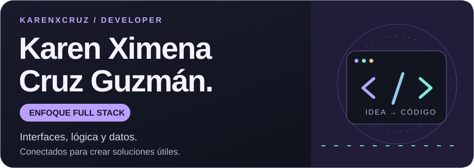
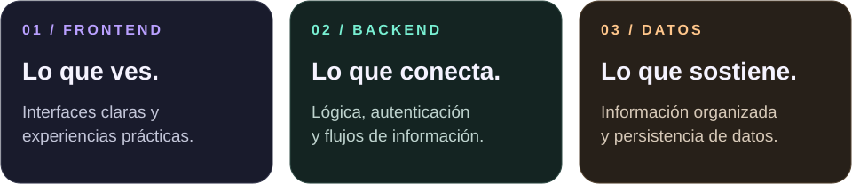
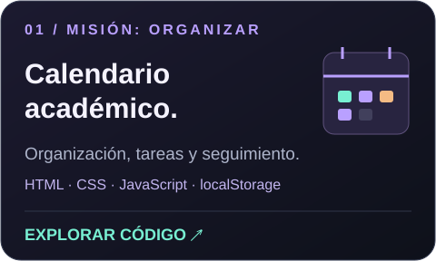
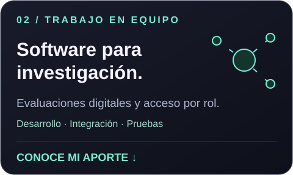

<!-- Perfil público de karenxcruz. Recursos visuales alojados en este repositorio. -->

  

  <a href="#sobre-mí">Sobre mí</a> ·
  <a href="#tecnologías">Tecnologías</a> ·
  <a href="#proyectos">Proyectos</a> ·
  <a href="#conectemos">Conectemos</a>

## Sobre mí

Soy **tecnóloga en Desarrollo de Software de la Universidad Surcolombiana**, con enfoque **full stack**. Me gusta trabajar tanto en lo que las personas ven como en la lógica y los datos que hacen funcionar una aplicación.

He trabajado en proyectos de facturación electrónica, sitios web empresariales, plataformas para investigación y herramientas académicas. Me interesa convertir necesidades reales en soluciones claras y prácticas, y seguir creciendo con cada proyecto.

  

## Tecnologías

Herramientas que he aplicado en mis proyectos:

  
  
  
  
  
  

Mis áreas de interés incluyen **desarrollo web, bases de datos, autenticación, integración de módulos y pruebas funcionales**.

## Proyectos

  
  

### Calendario académico dinámico

Herramienta web para organizar actividades académicas, consultar el calendario mensual y llevar un seguimiento de tareas pendientes y completadas.

**HTML · CSS · JavaScript · localStorage**

[Ver código ↗](https://github.com/karenxcruz/Calendario-Dinamico) · [Abrir aplicación ↗](https://calendario-dinamico.onrender.com)

<b>Explorar funcionalidades</b>

- Navegación por meses y actividades identificadas por colores.
- Consulta de tareas al seleccionar un día.
- Marcación de actividades completadas.
- Persistencia local en el navegador.
- Interfaz adaptable a dispositivos móviles.

### Investigación educativa

Participación como **integrante del equipo de desarrollo de software** en una plataforma web de apoyo a una investigación doctoral.

**Python · HTML · CSS · JavaScript · Firebase · Render**

<b>Explorar mi aporte al proyecto</b>

- Desarrollo e integración del módulo de evaluación NAJP.
- Implementación y mejora del inicio de sesión y el acceso por roles.
- Apoyo técnico a la integración de *Aventura en el Reino MT-A*.
- Desarrollo y ajuste de interfaces y paneles según el tipo de usuario.
- Integración de registros, instrumentos y flujos de información.
- Pruebas funcionales, corrección de errores y mejoras de usabilidad.

Trabajo realizado como parte de un equipo. Esta reseña presenta mi contribución sin publicar información de participantes ni materiales internos.

<b>Más áreas en las que he desarrollado proyectos</b>

- **Facturación electrónica:** soluciones para necesidades empresariales.
- **Sitios web empresariales:** presencia digital de empresas.
- **Aplicaciones y ejercicios académicos:** herramientas prácticas y proyectos universitarios.

Iré incorporando casos, capturas y repositorios a medida que los documente para este espacio.

## Formación

**Tecnología en Desarrollo de Software**  
Universidad Surcolombiana · Graduada en 2026

## Conectemos

Me interesa conectar con personas y equipos que construyan soluciones útiles, compartir lo que voy creando y explorar oportunidades de colaboración y desarrollo profesional.

[Explora mis repositorios ↗](https://github.com/karenxcruz?tab=repositories)

---

Aprender, construir y mejorar. Un proyecto a la vez.

